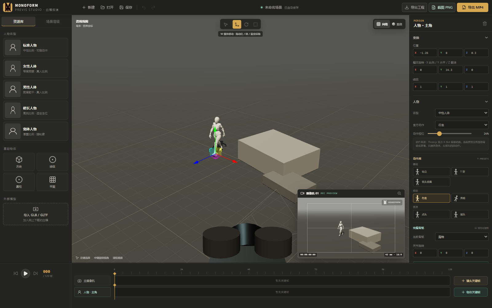
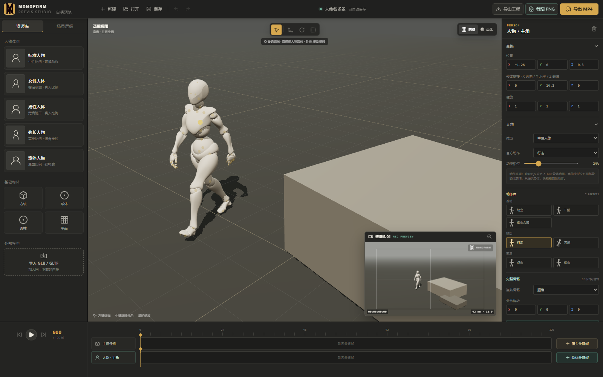
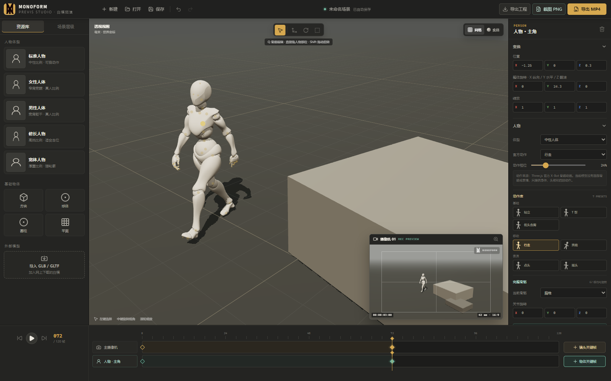

# 公众号发布稿｜MONOFORM 素形

## 标题

**我做了一个白模预演工具：人物、镜头和关键帧，都能在浏览器里完成**

## 摘要

一个面向分镜和镜头预演的轻量三维工具：内置骨骼人物，可快速搭景、调整摄像机，并制作人物与镜头关键帧。

---

# 我做了一个白模预演工具

做分镜时，经常会遇到这种情况：脑子里知道人物站在哪里、镜头从哪里拍，真正画出来后才发现空间、遮挡或焦距不对。

Blender 能解决这些问题，但如果只是快速验证走位和构图，完整三维软件有时显得太重。

所以我做了 **MONOFORM（素形）**——一个直接运行在浏览器里的白模预演工具。

## 人物、场景和镜头，都先粗略走一遍

工具内置了带骨骼的人物白模，无需另外寻找模型。可以选择不同体型和动作预设，也能直接点击人物关节调整姿势。人物共有 67 根可编辑骨骼，并支持自定义颜色。

场景可以用方块、球体、圆柱和平面快速搭建，也支持导入本地 GLB / GLTF 模型。物体可以像 Blender 一样移动、旋转和缩放，也能输入精确数值。

独立的摄像机窗口用于判断最终构图。工具支持 18–120 mm 焦距，以及 16:9、9:16、4:3、1:1、1.85:1、2.39:1 等常用画幅。

## 摄像机能动，人物也能动

时间轴分别记录摄像机和当前人物或物体的关键帧。

摄像机关键帧记录位置、观察目标和焦距；人物关键帧还会记录位置、旋转、动作相位和完整骨骼姿态。新建工程默认没有关键帧，所有动画都由用户主动设置。

最简单的使用方式只有几步：

1. 添加人物和基础物体，搭出大致空间。
2. 调整人物姿势、位置和颜色。
3. 设置摄像机位置、焦距和画幅。
4. 在起始帧和结束帧分别添加人物与镜头关键帧。
5. 播放检查后，导出 PNG、MP4 或 JSON 工程。

## 它不替代 Blender

MONOFORM 主要解决的是分镜前期的空间、走位和镜头验证。目前不包含高精度建模、面部表情、复杂灯光或最终角色动画，这些工作仍应交给专业三维软件。

它更像一张可以进入的动态分镜纸：先把人物、空间和镜头关系讲清楚，再进入正式制作。

## 在线体验

工具地址：

https://guiyi-xi.github.io/monoform-previs-studio/

4 分钟操作录屏：

https://guiyi-xi.github.io/monoform-previs-studio/tutorial/monoform-getting-started.mp4

GitHub：

https://github.com/GuiYi-Xi/monoform-previs-studio

**MONOFORM / 素形 · PREVIS STUDIO**

---

发布设置：封面短标题建议使用 **“让镜头先走一遍”**，原文链接填写在线工具地址。
